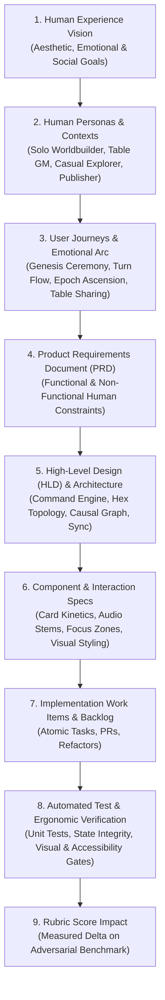
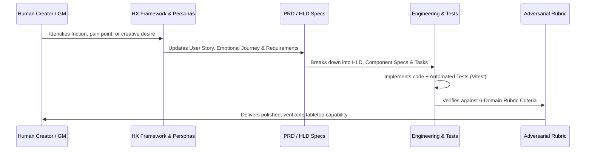

# Human Experience (HX)-Led Engineering & Governance Framework

> **Governance Document**: Core Operational Philosophy, Traceability Model, and Iteration Framework  
> **Effective Date**: 2026-11-07  
> **Status**: Accepted & Enforced  
> **Standard**: ADR-013 (Human Experience-Led Product Architecture)

---

## 1. Executive Summary & Core Philosophy

Too often, software projects descend into "feature checklists" and abstract architectural patterns that drift away from the lived reality of the human sitting in front of the screen. In tabletop worldbuilding, this failure mode results in sterile dashboards, mechanical button clicks, visual clutter, and broken immersion.

**The Human Experience (HX)-Led Framework mandates that every line of code, technical design, data structure, and automated test exists solely to serve, protect, and elevate the lived experience of the human creator, game master, or player.**

Technical excellence is not an end in itself; it is the scaffolding required to deliver uncompromised creative flow, emotional resonance, and frictionless tabletop collaboration.

---

## 2. The Traceability Hierarchy

Every engineering phase, component, and commit must trace directly through an unbroken pyramid from Human Need to Automated Verification:

### Traceability Rules:
1. **No Orphan Code**: No component or service may be authored without linking to a specific User Journey step and PRD requirement.
2. **Ergonomic Justification**: Complex technical systems (e.g., Command Pattern Undo, Hex Math, IndexedDB, WebRTC) must explicitly state which human frustration they eliminate.
3. **Continuous Score Attribution**: Every completed feature must document its exact contribution to the 6-Domain Adversarial Rubric.

---

## 3. Human Experience Principles for World Builder

Our system adheres to five uncompromising human-centric design tenets:

### Tenet 1: Ceremonial Gravity Over Casual Clicks
Modifying fundamental realities of a world (creating a realm, ending an age, configuring the player council) is not an administrative chore—it is a mythological event. These actions must feel weighty, deliberate, and consequential, utilizing visual staging, heraldic audio, and clear narrative pauses.

### Tenet 2: Unbroken Creative Flow State
The human mind in creative flow is fragile. Interruptions, accidental destructive clicks (e.g., painting over a capital city while trying to inspect lore), lost data, or confusing navigational states destroy immersion. We mandate:
- **Safe View by Default** on all cartography.
- **Unbreakable Multi-Domain Undo/Redo** so the user never fears experimenting.
- **Instant Auto-Save & Quota-Resilient Storage** so a browser crash or storage limit never loses an inscribed chronicle.

### Tenet 3: Zero-Confusion Spatial & Session Grounding
At every moment, the human user must intuitively know:
- *Where am I?* (Play Studio Main Menu vs. Active Realm Session vs. World Codex vs. Rules Reference).
- *Which realm am I in?* (Explicit world name, age, turn number, and breadcrumbs).
- *What mode is active?* (Safe Inspection Mode with green shield vs. Drafting Workshop with radiant gold ring).

### Tenet 4: Cognitive Zone Isolation & Progressive Disclosure
The tabletop canvas must never present 3,000 pixels of vertically stacked controls simultaneously. Administrative utilities (player roster seats, auto-play generator dials, JSON import/export, realm locking) must be tucked into collapsed focus-zone drawers and popovers, keeping the primary workspace clean and laser-focused on the active card and map.

### Tenet 5: Tabletop Respect & Frictionless Collaboration
Whether around a physical kitchen table with dice and cards or playing remotely over voice chat:
- Sharing must take seconds via compact QR code or instant URL, requiring **zero server logins, zero account creation, and zero paywalls**.
- Offline capability must be total—a GM in a cabin with no Wi-Fi can run an entire 4-age campaign seamlessly.

---

## 4. The Iteration & Governance Process

This framework is not static. It is designed to be refined iteratively as we learn from playtests, usability audits, and user feedback:

### Governance Commitments:
1. **Phase Audits**: At the conclusion of every milestone, review the deliverable against the intended User Experience, identify newly revealed ergonomic gaps, and record adjustments in `docs/DECISIONS.md`.
2. **Iterative Refinement**: When user testing reveals an assumption was flawed (e.g., a modal is too slow or a shortcut is unintuitive), the corresponding User Journey and PRD spec must be updated before code changes are made.
3. **Atomic Quality Delivery**: Every change must be verified via automated unit and integration tests, ensuring zero regression across all user workflows.
