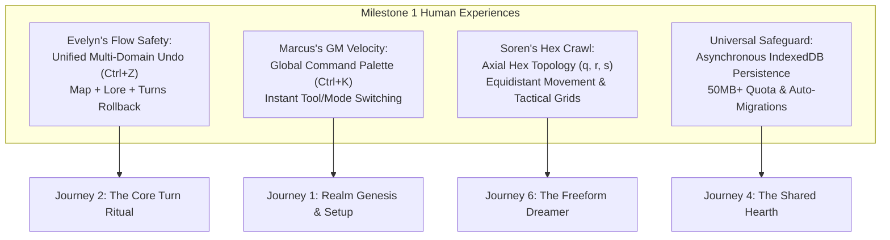
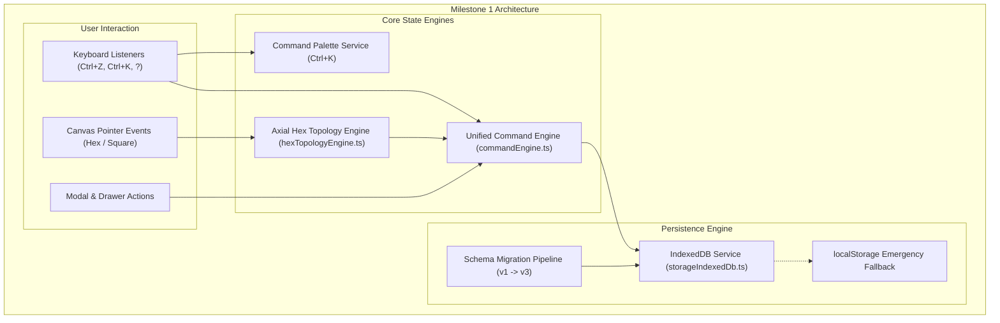

# Milestone 1 Specification: The Tabletop Foundation
## Resilient Creator Loop & Axial Hexagonal Cartography (Phases 17 & 18)

> **Milestone Document**: Implementation Plan, User Journeys, Architecture & Verification  
> **Target Score Delta**: 47.0 / 100 $\rightarrow$ **58.0 / 100** (+11.0 points)  
> **Target Personas**: Evelyn (The Solo Myth-Weaver), Marcus (The Live GM), Soren (The Tactical Cartographer)  
> **Standard**: ADR-013 (Human Experience-Led Product Architecture)

---

## 1. Executive Summary: What We Are Enabling & Why

In tabletop gaming and creative worldbuilding, the user's relationship with software hinges on two primary emotional pillars:
1. **Psychological Safety & Flow**: The creator must trust that the system will never lose their work, that mistakes are effortlessly reversible, and that the tool gets out of the way of their imagination.
2. **Authentic Spatial Verisimilitude**: Tabletop roleplayers, hex-crawl enthusiasts, and fantasy cartographers think in terms of **hexagonal grids**, where distance between neighboring cells is equidistant in all directions.

Milestone 1 addresses the most critical structural deficiencies identified in our adversarial audit:
* **Current Architectural Deficiency #1**: Undo/redo is fragmented. Only canvas tile clicks can be undone, and only within `MapCanvas.tsx`. If a user accidentally draws a card, modifies an entity, or progresses a turn, there is no rollback.
* **Current Architectural Deficiency #2**: Browser persistence is locked into synchronous `localStorage`, which is capped at ~5MB. Long-running, multi-age campaigns with hundreds of tiles and chronicle logs risk silent write failures or quota exhaustion.
* **Current Architectural Deficiency #3**: The cartography engine only supports square grids. Authentic tabletop RPGs (e.g., D&D wilderness travel, OSR hex crawls, Battletech, GURPS) require **axial hexagonal geometry ($q, r, s$)**.

---

## 2. Human User Journeys & Experiences Enabled

### Experience A: Evelyn's Fearless Creative Sandbox (PRD-4 & PRD-5)
* **The Journey**: Evelyn is drafting a deep chronicle for Year 450. She draws a card ("The Shattered Moon"), paints a catastrophic impact crater over three coastal tiles, and links the local Elven faction to the disaster. She then realizes she wanted to place the crater on the northern mountains instead.
* **What We Enable**: A single global `Ctrl+Z` (or clicking the header Undo button) reverses not just the tile paint, but also the linked lore and turn staging atomically.
* **Emotional Transformation**: From anxiety and hesitation ("Will I ruin my map if I try this idea?") to fearless creative experimentation.

### Experience B: Soren's Tactical Hex-Crawl Cartography (PRD-3)
* **The Journey**: Soren is preparing a wilderness campaign setting. He wants to map an ancient kingdom using standard 6-mile hexes, where traveling between any adjacent hex takes exactly the same movement cost.
* **What We Enable**: A 1-click toggle between `Orthogonal Square Grid` and `Axial Hexagonal Grid (Point-Topped & Flat-Topped)`. Hexes display clean coordinates `(q, r)` on hover, with a distance calculation ruler showing path distance in leagues.
* **Emotional Transformation**: From feeling like the tool is a "pixel paint toy" to feeling like an authentic AAA tabletop cartography workbench on par with *Wonderdraft* and *Worldographer*.

### Experience C: Marcus's Frictionless Game Master Velocity (PRD-1 & PRD-4)
* **The Journey**: Marcus is running a live session. He needs to quickly switch to Safe View mode, lookup the "Dwarven Clans" entity in the codex, mute the ambient soundscape because the players are discussing strategy, and advance to the next turn without hunting through menus.
* **What We Enable**: Marcus presses `Ctrl+K` (or `Cmd+K` on Mac). A spotlight command palette appears. He types `"mute"`, presses Enter; types `"dwarf"`, jumps directly to the dossier; types `"safe"`, locks the canvas.
* **Emotional Transformation**: The GM maintains table momentum with 0 seconds of UI hunting.

---

## 3. Structural & Architectural Improvements

### 1. Unified Transactional Command Pattern (`commandEngine.ts`)
* Replaces the local state inside `MapCanvas.tsx` with an application-level Command stack.
* Implements `execute()`, `undo()`, and `redo()` methods for:
  - Tile terrain painting, flora/relief stamping, and fog-of-war reveals.
  - Codex entity creation, modification, and deletion.
  - Turn basket actions and chronicle inscriptions.
* Groups rapid continuous drag operations into atomic composite transactions.

### 2. Asynchronous IndexedDB Storage Adapter (`storageIndexedDb.ts`)
* Native Promise-based wrapper around IndexedDB (with zero external dependencies).
* Increases client storage ceiling from **5MB (localStorage)** to **50MB–1GB+** depending on browser disk quota.
* Schema versioning with migration pipeline (`v1` $\rightarrow$ `v2` $\rightarrow$ `v3`).
* Automatic emergency fallback to `localStorage` if IndexedDB is blocked in private browsing mode.

### 3. Axial Hexagonal Topology Engine (`hexTopologyEngine.ts`)
* Implements canonical axial coordinates: $(q, r)$ with derived cubic coordinate $s = -q - r$ ($q + r + s = 0$).
* Pixel-to-Hex and Hex-to-Pixel math for point-topped and flat-topped orientations.
* Hex distance metric: $D(a, b) = \frac{|q_1 - q_2| + |r_1 - r_2| + |s_1 - s_2|}{2}$.
* Dynamic hex polygon path generation for SVG and Canvas 2D renderers.

### 4. Global Spotlight Command Palette (`CommandPalette.tsx`)
* Accessible via `Ctrl+K` or `Cmd+K`.
* Fuzzy search across all actions, modes, entities, and settings.
* Keyboard Shortcut Cheat Sheet accessible via `?` key.

---

## 4. Work Breakdown & Implementation Steps

Milestone 1 is executed across two sequential, atomic phases:

### Phase 17: Unified Transactional Command Engine & IndexedDB Resilience
* **Item 17.1**: Author `frontend/src/services/commandEngine.ts` with typed command interfaces, composite command grouping, and undo/redo stacks.
* **Item 17.2**: Author `frontend/src/services/storageIndexedDb.ts` with database initialization, object store transactions, and schema migration.
* **Item 17.3**: Build `frontend/src/components/CommandPalette.tsx` (`Ctrl+K`) and `KeyboardShortcutsModal.tsx` (`?`).
* **Item 17.4**: Connect `Play.tsx`, `MapCanvas.tsx`, and `TimelinePanel.tsx` to the unified command engine.
* **Item 17.5**: Write automated test suites: `commandEngine.test.ts`, `storageIndexedDb.test.ts`, and `CommandPalette.test.tsx`.

### Phase 18: Dual Hexagonal & Orthogonal Cartography Engine
* **Item 18.1**: Author `frontend/src/services/hexTopologyEngine.ts` with axial coordinate conversion, neighbor lookups, and hex distance metrics.
* **Item 18.2**: Update `MapCanvas.tsx` to support `gridType: 'square' | 'hex-pointy' | 'hex-flat'` with seamless coordinate rendering.
* **Item 18.3**: Update `cartographyShadingEngine.ts` and `exportService.ts` to render organic hillshading and SVG exports for hexagonal grids.
* **Item 18.4**: Add Hex Distance Ruler tool to canvas toolbar with league/mile readouts.
* **Item 18.5**: Write automated test suites: `hexTopologyEngine.test.ts` and hex rendering tests in `MapCanvas.test.tsx`.

---

## 5. Adversarial Rubric Score Trajectory

| Rubric Submetric | Current Baseline | Milestone 1 Target | Points Gained | Justification & Automated Verification |
| :--- | :---: | :---: | :---: | :--- |
| **D1.1 Studio Launcher & Navigation** | 2.5 / 5.0 | **3.5 / 5.0** | +1.0 | Global Command Palette (`Ctrl+K`) provides instant navigation. |
| **D2.1 Cartographic Grid & Topology** | 2.5 / 5.0 | **4.5 / 5.0** | +2.0 | Dual Axial Hexagonal ($q,r,s$) + Orthogonal topologies implemented. |
| **D2.4 Spatial Plausibility & Distance**| 2.0 / 5.0 | **3.0 / 5.0** | +1.0 | Hex distance formula and coordinate measurement ruler. |
| **D4.1 Safe Mode & Accidental Prevention**| 3.0 / 5.0 | **4.0 / 5.0** | +1.0 | Multi-domain atomic rollback prevents permanent accidental damage. |
| **D4.2 Undo/Redo & State Safety** | 2.0 / 5.0 | **4.5 / 5.0** | +2.5 | Unified Command pattern covering map, lore, and turns. |
| **D5.2 Error Boundaries & Recovery** | 2.5 / 5.0 | **3.5 / 5.0** | +1.0 | Safe transaction rollbacks on state transition errors. |
| **D5.4 Local Persistence & Quota** | 2.0 / 5.0 | **4.5 / 5.0** | +2.5 | IndexedDB replaces 5MB localStorage with 50MB+ capacity. |
| **Total Benchmark Score** | **47.0 / 100** | **58.0 / 100** | **+11.0 pts** | **Verified via Automated Test Suites** |
