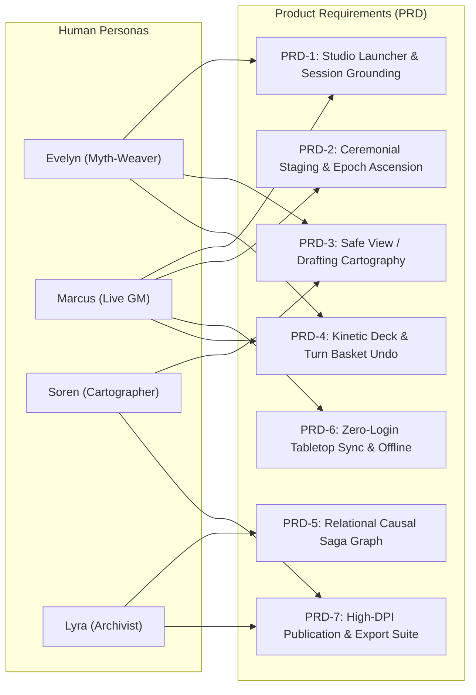
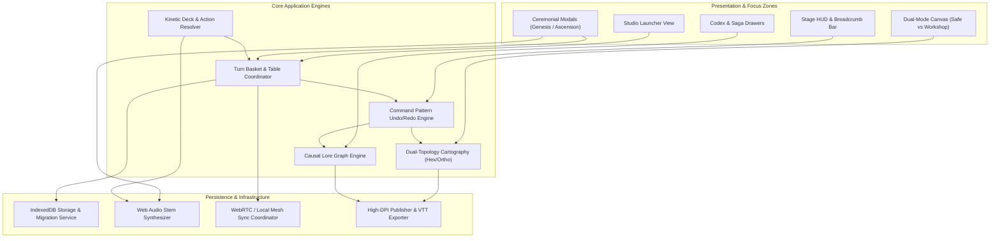

# Product Requirements (PRD), High-Level Design (HLD) & Component Specs

> **HX Framework Document**: Engineering Specifications & Technical Architecture  
> **Effective Date**: 2026-11-07  
> **Traceability Anchor**: Implements `docs/USER_JOURNEYS.md` → Guides `docs/ROADMAPPING.md`  
> **Standard**: ADR-013 (Human Experience-Led Product Architecture)

---

## 1. Product Requirements Document (PRD)

Every product requirement is explicitly derived from the needs of our 4 human personas and 6 user journeys.



---

### PRD-1: Studio Launcher & Session Spatial Grounding
* **Target Personas**: Marcus (GM), Evelyn (Solo Creator)
* **User Journey**: J1 (Awakening & Realm Genesis)
* **Problem**: Players accidentally overwrite campaigns or become disoriented about whether they are inside an active game, editing a template, or viewing rules.
* **Requirements**:
  1. Dedicated **Play Studio Launcher** with recent world cards, age badges, turn counters, and clear "New Game" / "Continue" CTAs.
  2. Distinct URL parameter state synchronization: `?world=<id>&mode=play|inspect|workshop|rules`.
  3. Persistent breadcrumb header displaying: `World Builder > [World Name] > Age [X] > Turn [Y]`.
  4. Quick Return-to-Launcher modal with dirty-state save confirmation.

---

### PRD-2: Ceremonial Staging & Epoch Ascension
* **Target Personas**: Marcus & Tabletop Circle, Evelyn
* **User Journey**: J1 (Realm Genesis), J3 (Epoch Ascension)
* **Problem**: Starting worlds or ending ages feels like clicking an administrative toggle rather than participating in a momentous tabletop ritual.
* **Requirements**:
  1. **New Game Genesis Stepper**: 4-step wizard (Realm Lore & Name $\rightarrow$ Time Scale & Epoch Limits $\rightarrow$ Council Roster & Seats $\rightarrow$ Terrain Seed).
  2. **Epoch Ascension Ceremony**: Triggered upon deck exhaustion. Pauses play to present:
     - Map evolution retrospective (before/after visual diff).
     - Deeds of Renown (summary of monuments built, wars fought).
     - Epilogue Lore inscription prompt.
     - Audio fanfare stem on ascension to next age.
  3. Modification of world rules (adding seats, altering turn timers) locked behind deliberate administrative confirmation modals.

---

### PRD-3: Dual-Mode Cartography & Safe Inspection Protection
* **Target Personas**: Soren (Cartographer), Evelyn (Myth-Weaver), Marcus (GM)
* **User Journey**: J2 (Turn Ritual), J6 (Freeform Dreamer)
* **Problem**: Mislclicking on the canvas while reading lore accidentally alters terrain or destroys cities.
* **Requirements**:
  1. **Safe View Mode (Default)**: Clicks only inspect tiles, display coordinate headers, and show historical lore. Paint tools completely disabled. Indicated by green "Protected" shield badge.
  2. **Drafting Workshop Mode**: Explicitly activated via toggle or hotkey (`W`). Border illuminates with glowing gold frame. Paint tools, stamps, and road builders unlocked.
  3. **Dual Hex & Ortho Topology**: Support both axial hexagonal coordinates ($q, r, s$) and square grid coordinates with seamless coordinate conversion.
  4. Layer toggles: Biome layer, elevation contours, political borders, POI pins, trade routes.

---

### PRD-4: Kinetic Deck & Turn Basket Multi-Level Undo
* **Target Personas**: Marcus & Sarah (Active Player), Evelyn
* **User Journey**: J2 (The Turn Ritual)
* **Problem**: Digital card draws lack physical card-draw tension; misclicks or mistakes cannot be undone without manually hacking state.
* **Requirements**:
  1. **Kinetic Card Mechanics**: Card draw animation with simulated 3D tilt, shadow depth, and tactile audio feedback (card flip stem).
  2. **Atomic Turn Basket**: During a turn, the player's card draw, power choice, painted tiles, and lore notes accumulate in an uncommitted staging basket.
  3. **Command Pattern Undo/Redo**: Full multi-level undo stack (`Ctrl+Z` / `Ctrl+Y`) for all canvas and staging actions before the turn is committed.
  4. **Turn Handoff Modal**: Clear modal when committing turn, displaying summary of deeds and prompting the next seat player.

---

### PRD-5: Relational Causal Saga Engine & Graph Lore
* **Target Personas**: Lyra (Lore Archivist), Evelyn
* **User Journey**: J2 (Turn Ritual), J3 (Epoch Ascension), J5 (Publication)
* **Problem**: Past events are recorded as isolated flat strings with no relational causality, entity tracking, or historical depth.
* **Requirements**:
  1. Every chronicle entry links to:
     - Originating card / turn / age.
     - Affected map coordinates ($q, r$ or $x, y$).
     - Involved Entities (Factions, Characters, Monuments, Relics).
     - Parent/Causal Event (e.g., "The Famine of Year 200" caused by "The Great Drought of Year 150").
  2. Entity Lifecycle: Entities can be Founded, Ascended, Divided, Ruined, or Lost to History.
  3. Interactive Lore Graph viewer showing timeline and entity connection network.

---

### PRD-6: Zero-Login Tabletop Peer Sync & Offline-First Persistence
* **Target Personas**: Marcus (GM), Tabletop Players
* **User Journey**: J4 (The Shared Hearth)
* **Problem**: Players at a game night refuse to create accounts or download apps just to participate in a shared session.
* **Requirements**:
  1. **Zero-Login QR Join**: GM clicks "Share Tabletop", generating a QR code and 6-char room code. Players scan and instantly connect via WebRTC / ephemeral relay.
  2. **Hotseat Device Passing**: If playing on 1 shared device, designated "Pass to Player [Name]" transition screens prevent peeking at private cards.
  3. **Offline-First Storage**: Primary storage in IndexedDB with LZ-string compression, surviving browser quota pressure with multi-slot automatic backups.

---

### PRD-7: High-DPI Cartographic Publication & Export Suite
* **Target Personas**: Lyra (Archivist), Soren (Cartographer), Evelyn
* **User Journey**: J5 (Master Scribe)
* **Problem**: Worldbuilders cannot easily share their creations as printable artifacts for campaign bibles or virtual tabletops.
* **Requirements**:
  1. **300 DPI Raster Export**: Export framed canvas regions to PNG/JPEG with customizable cartographic borders, compass rose, and scale bar.
  2. **Vector SVG & VTT Grid Export**: Export map with standard grid alignments for Roll20, Foundry VTT, and Fantasy Grounds.
  3. **Campaign Tome Generation**: Export a paginated HTML/PDF document containing the high-res map, faction dossiers, entity indexes, and chronological chronicle.

---

## 2. High-Level Design (HLD) Architecture



### 2.1 The Command Pattern State & Undo Engine
All state mutations on the world canvas, deck state, or turn progression must be encapsulated as reversible `Command` objects:
```typescript
interface Command<TState> {
  id: string;
  timestamp: number;
  description: string;
  execute(state: TState): TState;
  undo(state: TState): TState;
}
```
* **Benefits**:
  - Eliminates fear of destructive misclicks for users.
  - Enables effortless redo stack serialization.
  - Powers turn-based time scrubbing and replay generation.

### 2.2 Dual-Topology Cartographic Engine
The cartography engine handles two native coordinate representations seamlessly:
1. **Axial Hexagonal Coordinates ($q, r$)**:
   - Cube coordinates derived: $s = -q - r$.
   - Distance formula: $D = \frac{|q_1 - q_2| + |r_1 - r_2| + |s_1 - s_2|}{2}$.
   - Neighbor offsets for point-topped and flat-topped orientations.
2. **Orthogonal Coordinates ($x, y$)**:
   - Bounded 2D grid matrix with standard 4-way and 8-way connectivity.
3. **Dual Renderer**:
   - WebGL / Canvas 2D batch renderer capable of sustaining 60 FPS on 10,000 hex tiles with zoom and pan.

### 2.3 Causal Knowledge Graph Lore Engine
Lore entries are stored as a directed acyclic graph (DAG):
```typescript
interface SagaNode {
  id: string;
  turnNumber: number;
  ageIndex: number;
  text: string;
  coordinates?: [number, number];
  entityIds: string[];
  causedByNodeId?: string;
  consequenceNodeIds: string[];
}
```
* Queries allow immediate traversal: "Find all consequences stemming from the Cataclysm of Year 50."

### 2.4 Persistence & Quota Resilience Architecture
* Storage relies on **IndexedDB** (`idb-keyval` or native wrapper) with **localStorage** as an emergency fallback.
* World states exceeding 500KB are compressed using **LZ-string**.
* Schema versions are monotonically tracked with automated migration scripts from Schema v1 to vN.

---

## 3. Product & Component Design Specifications

### 3.1 Focus Zone Layout Hierarchy
To eliminate visual clutter, the screen is strictly partitioned into 4 non-overlapping focus zones:
1. **Zone A: Celestial Breadcrumb Bar (Top 48px)**:
   - Left: Home/Launcher button, Realm Name, Age Pill, Turn Pill.
   - Center: Mode Indicator (Safe View Green Shield vs. Workshop Golden Ring).
   - Right: Share Hearth button, Sound Mute toggle, Administrative Settings drawer trigger.
2. **Zone B: Main Canvas & Stage (Flexible Center)**:
   - Zoom/Pan viewport displaying active map, grid overlay, and POI markers.
3. **Zone C: Kinetic Turn Console (Bottom-Center Floating Bar)**:
   - Active Player Avatar, Card Draw trigger, Power Action selector, Turn Basket Commit button.
4. **Zone D: Collapsed Sliding Drawers (Left & Right Flanks)**:
   - Left Drawer: Chronicle & Saga Graph (opens on demand).
   - Right Drawer: Palette & Brush Tools (only accessible when in Workshop Mode).

### 3.2 Audio Stem Synthesis Specification
To avoid heavy multi-megabyte sound file assets, the application utilizes the native browser **Web Audio API**:
* **Fanfare**: Arpeggiated brass chord (sine + triangle oscillators with short attack and rich reverb).
* **Card Rustle**: Filtered white noise burst with exponential volume decay.
* **Quill Inscription**: Gentle dual-frequency click bursts mimicking nib on parchment.
* **Safe Mode Clink**: High crisp metallic bell tone confirming mode switch.

---

## 4. Adversarial Rubric Verification & Score Roadmap

Every PRD item directly targets the 6 domains of [`docs/AUDIT_RUBRIC.md`](file:///c:/dev/world-builder-site/world-builder-site/docs/AUDIT_RUBRIC.md):

| PRD Module | Targeted Rubric Submetrics | Baseline Score | Projected Impact | Target Score |
| :--- | :--- | :---: | :---: | :---: |
| **PRD-1: Studio Launcher & Grounding** | D1.1 (Launcher), D1.3 (Spatial), D4.4 (Session Routing) | 2.5 / 17 | +5.5 | **8.0 / 17** |
| **PRD-2: Ceremonial Staging & Epochs** | D1.4 (Ceremonies), D3.1 (Aesthetic), D5.3 (Sound) | 2.0 / 17 | +6.0 | **8.0 / 17** |
| **PRD-3: Dual Cartography & Safe Mode**| D2.1 (Carto), D2.4 (Procedural), D4.1 (Safe Mode) | 3.5 / 17 | +6.5 | **10.0 / 17** |
| **PRD-4: Kinetic Deck & Turn Basket** | D1.2 (Kinetic), D4.2 (Undo/Redo), D5.1 (Audio) | 2.0 / 16 | +7.0 | **9.0 / 16** |
| **PRD-5: Relational Causal Saga Graph**| D3.2 (Relational), D3.4 (Genealogy), D6.3 (Cross-Links) | 1.5 / 17 | +6.5 | **8.0 / 17** |
| **PRD-6: Zero-Login Sync & Persistence**| D4.3 (Sync), D5.4 (IndexedDB), D6.4 (Offline) | 1.5 / 16 | +7.5 | **9.0 / 16** |
| **PRD-7: High-DPI Publication Suite** | D2.3 (Multi-Layer), D6.1 (Tome PDF), D6.2 (VTT Export) | 2.0 / 17 | +6.0 | **8.0 / 17** |
| **Totals** | **All 24 Submetrics** | **47.0 / 100** | **+45.0** | **92.0 / 100** |
