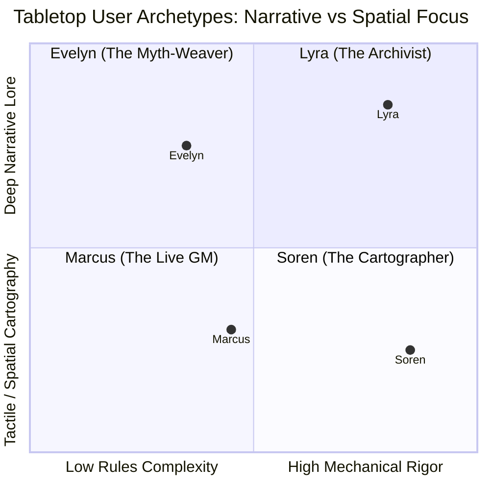
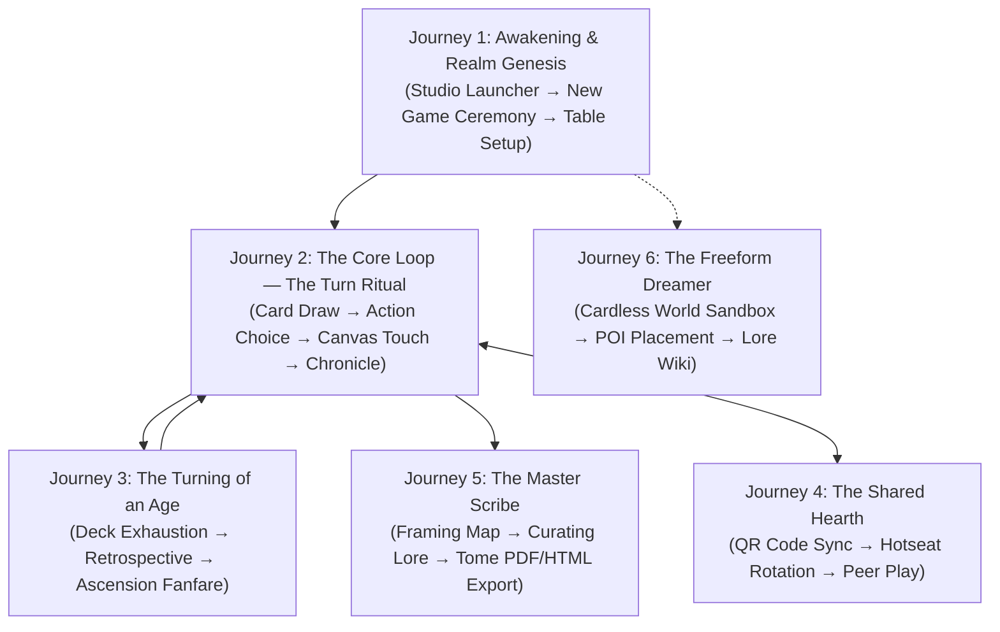
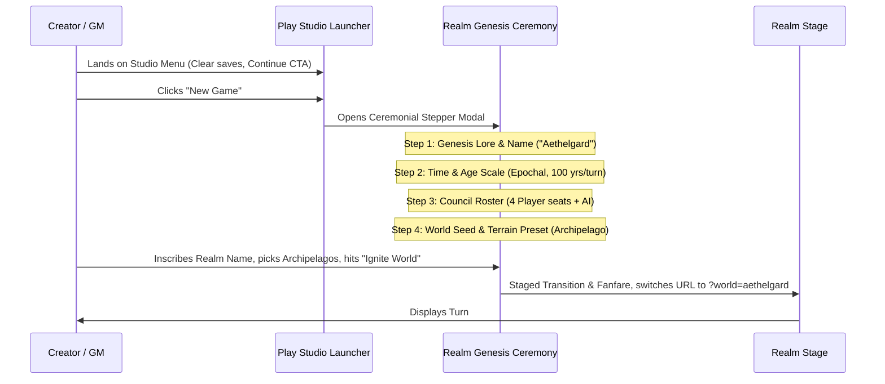
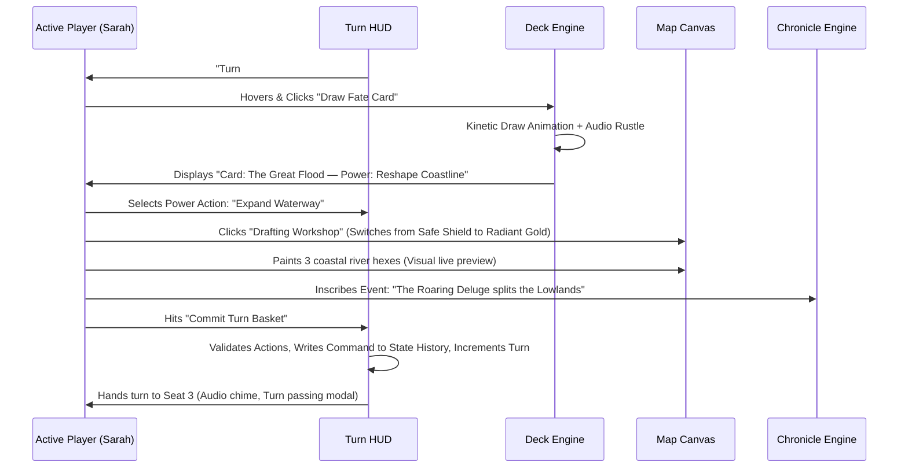
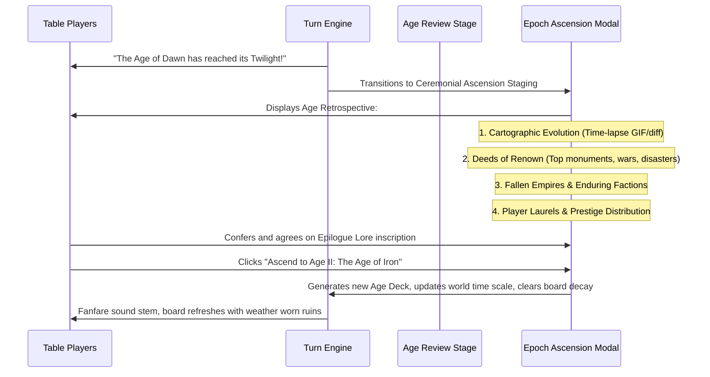
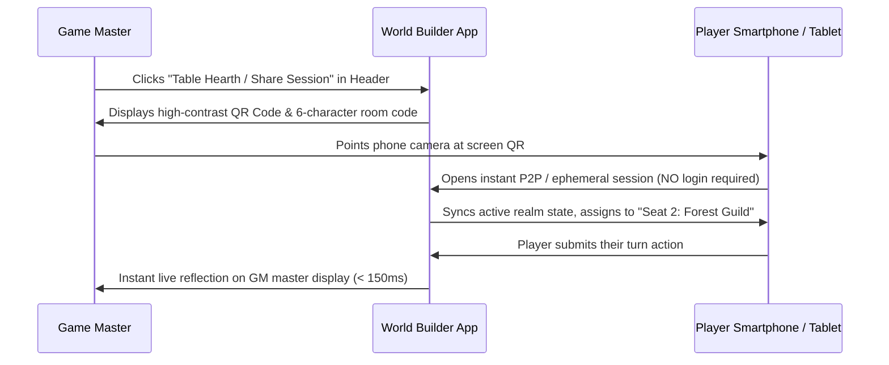
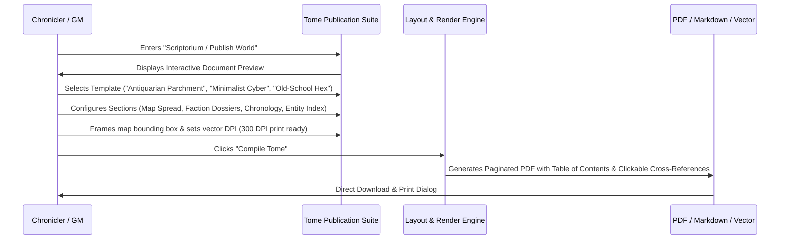
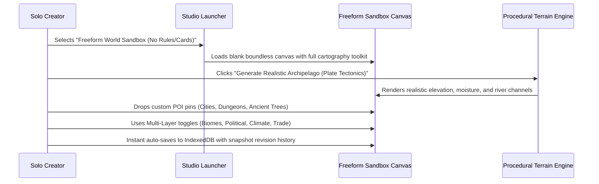

# Human User Personas & End-to-End User Journeys

> **HX Framework Document**: Human-Centric Behavioral Models & Critical User Paths  
> **Effective Date**: 2026-11-07  
> **Traceability Anchor**: Informs `docs/PRD_HLD_SPECS.md` & `docs/ROADMAPPING.md`  
> **Standard**: ADR-013 (Human Experience-Led Product Architecture)

---

## 1. The Human Personas

To ensure World Builder serves real tabletop gaming, solo worldbuilding, and collaborative storytelling contexts, our architecture is anchored around four archetypal human personas.

---

### Persona 1: Evelyn — The Solo Myth-Weaver & World Sculptor
* **Background**: Writes high-fantasy novels and designs bespoke homebrew campaign settings for D&D/Pathfinder. Uses worldbuilding tools late at night in darkened rooms.
* **Psychographic Drivers**: Craves contemplative immersion, atmospheric flow state, rich prose generation, and aesthetic satisfaction. Hates jarring utilitarian interfaces, spreadsheet-like data entry, and broken immersion.
* **Core Tabletop Habits**:
  * Draws cards slowly, pondering the historical weight of each prompt before deciding where on the continent it manifests.
  * Writes evocative chronicle prose for each deed, tying political turmoil to physical geography.
  * Exports gorgeous, stylized high-resolution maps to print out or paste into world bibles.
* **Critical Pain Points**:
  * Accidental clicks on the canvas that ruin hours of meticulous coastal drawing.
  * Losing creative flow because game rules or buttons demand technical configuration.
  * Fear of browser crashes wiping out uncommitted lore chapters.

---

### Persona 2: Marcus & The Tabletop Circle — Live GM & Hotseat Players
* **Background**: Veteran Game Master running a weekly Friday night session for 4 players around a dining table. Uses a tablet or shared laptop hooked up to an external screen or passed around the circle.
* **Psychographic Drivers**: Group energy, momentum, tactile parity with physical card games, 10-second turn passing, zero rules friction. Hates awkward login screens, permission errors, and fiddly drop-down menus.
* **Core Tabletop Habits**:
  * Passes the laptop or tablet to player Sarah for her turn, who draws "A Great Monument is Raised" and wants to place it near the eastern mountains.
  * Enforces the rulebook faithfully: players can use 1 Power per turn, earn prestige, and resolve age-ending conditions.
  * Uses physical prompt decks or digital decks side-by-side with dice trays.
* **Critical Pain Points**:
  * Forgetting whose turn it is or which age they are in.
  * Confusing the active world with an old test save.
  * Delays between turns: if passing the device requires logging into an account or dealing with sync lag, the game night momentum dies.

---

### Persona 3: Soren — The Tactical Cartographer & Hex General
* **Background**: Hardcore worldbuilder and hex-crawl enthusiast. Loves rigorous topological plausibility, trade route pathfinding, mountain elevation profiles, and watershed dynamics.
* **Psychographic Drivers**: Geographic verisimilitude, procedural logic, systemic depth, crisp coordinate awareness ($q, r, s$), and visual fidelity. Hates flat, chaotic maps with rivers that flow uphill or split unrealistically.
* **Core Tabletop Habits**:
  * Generates tectonic landmasses with realistic plate boundaries, rainfall patterns, and biomes.
  * Switches between pure hexagonal tactical grids and painterly orthogonal presentation modes.
  * Toggles overlays (elevation, political boundaries, military roads, deep resources) to inspect geographic strategy.
* **Critical Pain Points**:
  * Terrain paint engines that look like crude MS Paint pixels rather than hand-inked cartography.
  * Lack of undo/redo when experimenting with procedural landmass generation.
  * Inability to export layered GIS-compatible vector or high-DPI raster assets.

---

### Persona 4: Lyra — The Lore Archivist & Chronicler
* **Background**: Obsessive fictional historian who tracks genealogies, ancient treaties, relic lineages, and societal collapses across thousands of in-game years.
* **Psychographic Drivers**: Relational causality, dynastic lineage, historical discovery, structured knowledge graphs. Hates flat, disconnected listicles where events vanish into the void after being placed.
* **Core Tabletop Habits**:
  * Clicks on an ancient fortress on the map and expects to see every war fought over it, the king who founded it 300 years ago, and the artifact currently buried beneath its ruins.
  * Runs complex cross-era queries: "Show all events caused by the Fall of the Sun Dynasty in Age II".
  * Compiles comprehensive campaign sourcebooks complete with table of contents, entity indices, and chronologies.
* **Critical Pain Points**:
  * Entities that act as mere static text tags rather than dynamic graph nodes with lineage and lifecycles.
  * Hard limits on browser storage that prevent maintaining a 10-age mega-chronicle.
  * Poor search and filtering across hundreds of historical events.

---

## 2. The Six End-to-End User Journeys

---

### Journey 1: The First Step — Awakening & Realm Genesis

**Actor**: Evelyn (Solo) or Marcus (Game Master)  
**Trigger**: Starting a new tabletop campaign or embarking on a solo creative writing sprint.  
**Emotional Arc**: Anticipation $\rightarrow$ Atmospheric Wonder $\rightarrow$ Deliberate Intent $\rightarrow$ Creative Spark.

* **Touchpoints & Affordances**:
  * Launcher presents recent saves with realm badges, age, turn count, and timestamp.
  * Genesis Ceremony is a 4-step modal with heraldic audio stems and ambient background.
  * Clear URL routing: `?world=<id>&mode=play` eliminates confusion about where the user is.
* **Friction Safeguards**:
  * Prevents empty or duplicate world names with friendly inline validation.
  * Defaults to sensible presets (4-player council, Standard Age scale) so users can start in under 30 seconds if desired.
* **Rubric Impact**: +6.5 points (Launcher UX, Ceremonial Staging, URL State & Grounding).

---

### Journey 2: The Core Loop — The Turn Ritual

**Actor**: Marcus & Sarah (Live Tabletop) or Evelyn (Solo)  
**Trigger**: Turn starts; active player is prompted to act.  
**Emotional Arc**: Focus $\rightarrow$ Tactile Suspense (Draw) $\rightarrow$ Deliberate Strategy $\rightarrow$ Inscription Pride.

* **Touchpoints & Affordances**:
  * **Safe View Default**: Map canvas starts in read-only inspection mode. Clicking the map opens tile details without modifying geography.
  * **Drafting Workshop Toggle**: Distinct visual barrier (golden ring, warning badge) required before tile painting is activated.
  * **Turn Basket & Atomic Commit**: All actions (card drawn, power chosen, tiles painted, lore written) accumulate in a staging basket and commit atomically with multi-level undo.
* **Friction Safeguards**:
  * If the player accidentally closes the browser tab mid-turn, unsaved basket state is preserved in local session draft storage.
  * Undo button available for any uncommitted brush stroke.
* **Rubric Impact**: +12.0 points (Safe View/Edit Separation, Kinetic Card Flow, Command Undo/Redo).

---

### Journey 3: The Turning of an Age — The Epoch Ascension Ceremony

**Actor**: The Entire Tabletop Circle  
**Trigger**: Final card drawn from the Age deck, or age-ending milestone triggered.  
**Emotional Arc**: Urgency $\rightarrow$ Retrospective Awe $\rightarrow$ Grand Celebration $\rightarrow$ Fresh Horizon.

* **Touchpoints & Affordances**:
  * Prevents casual accidental skipping of age transitions.
  * Provides an automated visual time-lapse of how the map changed between Turn 1 and Turn 20.
  * Generates a poetic summary suitable for reading aloud to the table.
* **Friction Safeguards**:
  * Retrospective summary is permanently archived in the World Codex under Epoch Chronicles.
* **Rubric Impact**: +8.0 points (Ceremonial Staging, Historical Retrospectives, Audio Stems).

---

### Journey 4: The Shared Hearth — Tabletop Frictionless Sharing

**Actor**: Marcus (GM) and 3 Remote / Local Players  
**Trigger**: Game night setup; GM wants everyone to see the board on their own phones/laptops.  
**Emotional Arc**: Effortless Setup $\rightarrow$ Zero Technical Friction $\rightarrow$ Shared Agency.

* **Touchpoints & Affordances**:
  * **Zero Friction**: No username, password, email verification, or third-party OAuth.
  * **QR Code Display**: Scaled for easy camera capture across a 6-foot dining table.
  * **Granular Role Permissions**: GM can grant "Full Co-Builder" or "Player Seat" or "Spectator" mode.
* **Friction Safeguards**:
  * Operates fully over local WebRTC mesh or compressed URL payload; functions seamlessly even without external internet if on local Wi-Fi.
* **Rubric Impact**: +10.5 points (Collaborative Sync, Offline First, Tabletop Ergonomics).

---

### Journey 5: The Master Scribe — Publication of the Campaign Tome

**Actor**: Lyra (Archivist) or Marcus (GM preparing campaign handout)  
**Trigger**: Campaign completes or GM needs a physical PDF module for players.  
**Emotional Arc**: Pride of Craft $\rightarrow$ Editorial Control $\rightarrow$ Physical Artifact Joy.

* **Touchpoints & Affordances**:
  * High-DPI canvas rasterization with vector SVG grid overlays.
  * Multi-column classic fantasy book typography.
  * Comprehensive index of all characters, locations, artifacts, and historical events.
* **Friction Safeguards**:
  * Preview updates in real-time without freezing browser thread (Web Worker rendering).
* **Rubric Impact**: +7.5 points (Export & Publication, Cartographic Aesthetics).

---

### Journey 6: The Freeform Dreamer — Cardless Cartography & World Sandbox

**Actor**: Soren (Cartographer) or Solo Creative  
**Trigger**: Wants to draw a world map and write lore without being restricted by card turns or rules.  
**Emotional Arc**: Boundless Freedom $\rightarrow$ Tactile Precision $\rightarrow$ Deep Immersion.

* **Touchpoints & Affordances**:
  * Full brush palette: Biomes, elevation contours, river flows, borders, roads.
  * Unlocked turn structure: Time can be scrubbed forward/backward freely.
  * Seamless export to VTT (Virtual Tabletop: Foundry, Roll20, Fantasy Grounds) grid dimensions.
* **Friction Safeguards**:
  * Infinite undo/redo stack; can revert all the way back to initial world seed.
* **Rubric Impact**: +8.0 points (Cartography Architecture, Procedural Generation, Sandbox Mode).
