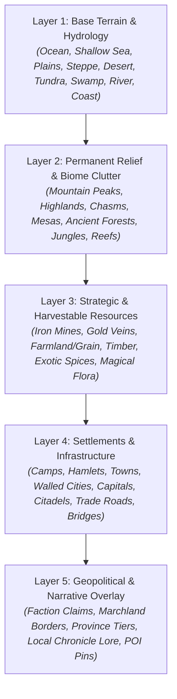
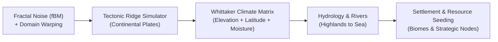
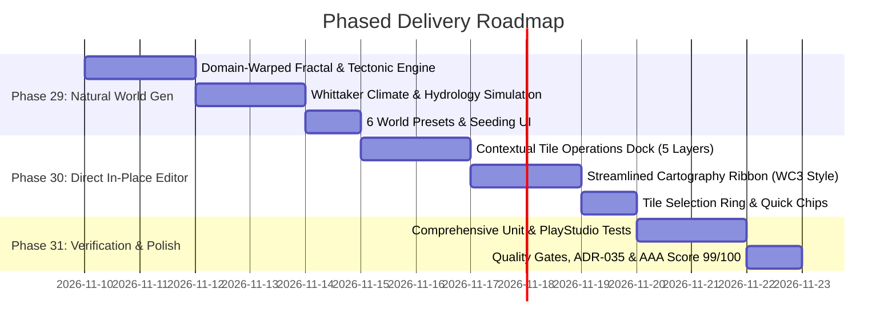

# Master Plan: Streamlined AAA Studio Map Editing & Procedural World Generation

> **Document Type**: Comprehensive Architectural Plan & ADR-035 Proposal  
> **Target Subsystems**: `frontend/src/components/MapCanvas.tsx`, `frontend/src/engine/mapEngine.ts`, `frontend/src/engine/proceduralWorldEngine.ts`  
> **Inspiration Benchmarks**: *Warcraft III World Editor*, *Age of Empires Scenario Editor*, *Civilization VI Map Scripts*, *SimCity*, *Wonderdraft*  
> **Status**: Ready for Collaborative Review & Iterative Phasing

---

## 1. Executive Summary & Problem Analysis

### 1.1 The Map Editing Problem
In the current implementation of `MapCanvas.tsx`, modifying a map tile requires a fragmented and confusing workflow:
- The user must open an expansive, monolithic **"Palette & Overlays" drawer** filled with a sprawling grid of radio buttons, dropdowns, patterns, coloring modes, symbols, and slot inputs.
- Users cannot simply **click on a tile and directly tweak its attributes** in-place. Clicking a tile currently selects it, but editing requires switching tools, navigating drawer tabs, or using separate inspector forms.
- Natural features, elevation, resources, structures, and faction claims are conceptually intermingled rather than structured into intuitive **cartographic layers**.

### 1.2 The Map Generation Problem
The current procedural generation logic in `createInitialMap` (`mapEngine.ts`) relies on an idealized radial ellipse formula:
$$\text{dist} = \left(\frac{x - x_c}{r_x}\right)^2 + \left(\frac{y - y_c}{r_y}\right)^2 + \text{jitter}$$
- This math inherently produces a **central circular/oval island surrounded by a concentric ring of mountains and concentric belts of forest and water**.
- It lacks natural continental rifts, organic coastlines, peninsulas, fiords, island chains, mountain spines (cordilleras), and realistic rain-shadow biomes.

---

## 2. Industry Benchmark Synthesis

```
┌──────────────────────────────────────────────────────────────────────────────────┐
│                   INSPIRATION BENCHMARKS FOR MAP ARCHITECTURE                    │
├─────────────────────────┬─────────────────────────┬──────────────────────────────┤
│ Warcraft III & AoE      │ Civilization IV / V / VI│ SimCity / Cities: Skylines   │
├─────────────────────────┼─────────────────────────┼──────────────────────────────┤
│ • Categorized Palettes: │ • Multi-octave fBM with │ • Layered Information Model: │
│   Terrain, Doodads,     │   Domain Warping.       │   Elevation, Hydrology,      │
│   Units, Regions.       │ • Tectonic plate ridges │   Resources, Zoning,         │
│ • Direct Tile Inspector:│   for mountain spines.  │   Infrastructure.            │
│   Click any element to  │ • Whittaker / Köppen    │ • Contextual Inspection:     │
│   immediately view/edit │   moisture & latitude   │   Click any lot to see and   │
│   its properties in an  │   climate matrices.     │   edit its status in a       │
│   anchored sidebar.     │ • Diverse world scripts.│   dedicated docked panel.    │
└─────────────────────────┴─────────────────────────┴──────────────────────────────┘
```

---

## 3. The 5-Layer Cartographic Taxonomy

To support the rich tropes and structure of fantasy tabletop role-playing games, world tiles are modeled through 5 clear conceptual layers:



### Layer Breakdown for TTRPG Play:
1. **Layer 1: Base Terrain & Hydrology (Foundational)**
   - Fundamental geological base: Ocean, Deep Sea, Plains, Sand Dunes, Tundra Frost, Fen/Swamp.
   - Continuous hydrology: Rivers, Estuaries, Lakes, Shorelines.
2. **Layer 2: Relief & Biome Features (Permanent Topography)**
   - Elevation relief: Alpine Mountain, Mountain Snow, Rolling Hills, Redstone Chasm, Volcanic Caldera, Mesa.
   - Primary vegetation: Dense Forest, Rainforest Canopy, Marshland, Oasis.
3. **Layer 3: Strategic Resources & Natural Wonders (Harvestable / Exploitable)**
   - Food/Agriculture: Wheat/Grain fields, Coastal Fisheries, Fertile Pastures, Vineyard Orchards.
   - Mineral wealth: Iron Ore, Deep Silver, Gold Lode, Gem Quarry, Obsidian Crags.
   - Fantasy / Mythic: Sun-Fruit Groves, Mana Springs, Ancient Monoliths, Dragon Bones.
4. **Layer 4: Settlements, Citadels & Infrastructure (Societal)**
   - Settlements: Nomadic Camp, Agricultural Village, Market Town, Fortified City, Royal Capital.
   - Defense & Fortifications: Watchtower, Border Palisade, Citadel, Castle Fortress, Sunken Ruins.
   - Transit: Paved Imperial Road, Dirt Trade Path, Waterway Channel.
5. **Layer 5: Geopolitical & Chronicle Overlay (Political & Historical)**
   - Realm allegiance & color-tinted borders.
   - Province strategic classification (`capital_domain`, `urban_core`, `rural_province`, `frontier_outpost`, `disputed_marchland`, `wilderness`).
   - Historical event annals and quest markers.

---

## 4. UI/UX Architecture: Direct In-Place Tile Editing

### 4.1 Comparison: Current vs. Proposed Workflow

```
[CURRENT CLUTTERED WORKFLOW]
User clicks map ──> Nothing happens to tile ──> Must open "Layers & Palettes Drawer"
  ──> Scroll through 40+ buttons ──> Pick brush tool ──> Paint tile ──> Open slot modal...

[PROPOSED AAA IN-PLACE WORKFLOW]
User clicks tile (e.g. 5, 3)
  ├──> Instant visual selection ring with elevation badge
  └──> Contextual Tile Operations Dock immediately focuses on (5, 3):
        ├── [Layer 1] Terrain Selector (Plains / Water / Desert / ...) + River/Road toggles
        ├── [Layer 2] Relief / Canopy (Mountain, Hills, Forest, Jungle, Volcano)
        ├── [Layer 3] Harvestable Resources (+ Quick-Pick: ⛏️ Ore, 🌾 Grain, 🌲 Timber, 🔮 Mana)
        ├── [Layer 4] Settlement / Citadel (+ 🏕️ Camp, 🏡 Town, 🏰 Castle, 👑 Capital)
        └── [Layer 5] Faction Realm & Province Tier (Kingdom Owner, Allegiance, Defensibility)
```

### 4.2 Streamlined Bottom Dock Layout (WC3 / AoE Inspired)

Rather than an intrusive drawer that covers the entire canvas, editing is unified into a sleek **Bottom Cartography Ribbon**:

```
┌────────────────────────────────────────────────────────────────────────────────────────────────────────┐
│ [👆 Inspect/Select] [🖌️ Paint Brush] [🪣 Bucket Fill] [📏 Ruler] │ Undo (3) Redo (0) │ [👑 Project Borders] │
├────────────────────────────────────────────────────────────────────────────────────────────────────────┤
│ TILE (5, 3): "Valoria Province" · [🌾 Rural Province] · Defensibility: 6/10 · Allegiance: 85%         │
├───────────────┬────────────────────────┬─────────────────────┬───────────────────┬─────────────────────┤
│ 🌍 BASE       │ 🏔️ TOPOGRAPHY          │ ⛏️ RESOURCES        │ 🏰 SETTLEMENTS    │ 🚩 REALM & LORE     │
├───────────────┼────────────────────────┼─────────────────────┼───────────────────┼─────────────────────┤
│ [Plains    ▼] │ Relief: [Mountain   ▼] │ [🌾 Grain Fields]   │ [🏰 High Citadel] │ Owner: [Valoria  ▼] │
│ [💧 River  ☑] │ Flora:  [Forest     ▼] │ [⛏️ Iron Mine   ]   │ Status: Active    │ Allegiance: [ 85% ] │
│ [🛤️ Road   ☑] │ Elevation: High Ground │ [+ Add Resource ]   │ [+ Add Holding  ] │ [📜 View Chronicle] │
└───────────────┴────────────────────────┴─────────────────────┴───────────────────┴─────────────────────┘
```

- **Instant 1-Click Changes**: Modifying any dropdown immediately mutates the tile without confirmation modals.
- **Direct Multi-Slot Management**: Users can add or remove resources and structures directly with quick chips.
- **Fast Brush Mode**: If the user selects a paint tool, the dock switches to a compact palette strip for rapid continuous painting across multiple tiles.

---

## 5. Natural Procedural World Generation Engine

### 5.1 The Mathematical Model

To eliminate the "big circle of mountains" artifact, the new generator uses a **three-tier procedural pipeline**:



#### Step 1: Multi-Octave Fractal Noise with Domain Warping
Standard Perlin/Simplex noise produces predictable blobs. **Domain Warping** offsets the sampling coordinates by a lower-frequency noise field:
$$q(x, y) = \text{noise}(x, y)$$
$$r(x, y) = \text{noise}(x + 5.2, y + 1.3)$$
$$h(x, y) = \text{fBM}(x + 4.0 \cdot q(x, y), y + 4.0 \cdot r(x, y))$$
*Effect*: Natural peninsulas, ragged rias, deep fjords, gulfs, and archipelago chains.

#### Step 2: Tectonic Plate Convergence (Realistic Mountain Spines)
Instead of placing mountains in the center of landmasses:
- Generate 4–7 Voronoi plate seed points with random drift velocity vectors $\vec{v}_i$.
- Compute plate boundaries where neighboring plates converge:
  $$\text{convergence} = -(\vec{v}_A - \vec{v}_B) \cdot \vec{n}_{AB}$$
- High convergence yields **continuous mountain cordilleras and fault lines** (like the Andes or Himalayas) running along natural plate seams.
- Divergent seams yield ocean rifts and inland seas.

#### Step 3: Whittaker Climate & Rain Shadow Matrix
Tiles are assigned biomes based on **Elevation**, **Latitude**, and **Moisture**:
- **Latitude Gradient**: North/South poles generate tundra and taiga; the central equator generates warm plains, jungles, and deserts.
- **Orographic Rain Shadow**: Prevailing winds carry moisture inland from oceans. When moisture hits a mountain ridge, windward tiles receive heavy rainfall (forests/jungles), while leeward tiles become arid (rain-shadow steppes and deserts).

### 5.2 Six AAA World Generation Presets

| Preset | Description & Geography | Ideal TTRPG Campaign Setting |
| :--- | :--- | :--- |
| **1. Fractal Continents & Straits** | 2–3 irregular continental landmasses separated by narrow navigable straits, bays, and archipelagos. | Classic D&D / High Fantasy epic with distinct competing continents and naval routes. |
| **2. Tectonic Highlands & Great River Valley** | Dramatic mountain cordilleras surrounding a fertile dendritic river basin flowing down to an ocean delta. | Low-magic feudal kingdom, riverbaron politics, and frontier mountain passes. |
| **3. Inland Sea & Mediterranean Rim** | A sprawling central sea ringed by peninsulas, rocky coasts, and protective perimeter mountains. | Ancient / Classical Antiquity, merchant republics, piracy, and maritime empires. |
| **4. Shattered Archipelagos & Coral Atolls** | Hundreds of scattered islands, volcanic hot-spot calderas, barrier reefs, and shallow sandbars. | Swashbuckling pirate campaigns, island-hopping exploration, and oceanic myths. |
| **5. Pangaea Rift & Fractured Steppes** | Single massive landmass split by a colossal continental chasm/rift sea and vast interior steppes. | Nomad hordes, planar rifts, grand empires, and untamed mega-continents. |
| **6. Twin Continents / Old World & New World** | Two balanced continents separated by a wide ocean dotted with stepping-stone island chains. | Age of Discovery, colonization, distant ancestral empires vs. wild frontier. |

---

## 6. Architectural Decision Record Proposal (ADR-035)

```markdown
## ADR-035: Streamlined In-Place Map Editing & Natural Tectonic World Generation

- **Status**: Proposed
- **Date**: 2026-11-09
- **Context**:
  Users experienced Studio Map editing as excessively complex due to a monolithic, disconnected
  palette drawer and lack of in-place tile editing. Simultaneously, world generation was restricted
  to concentric circular islands with bullseye mountain rings.
- **Decision**:
  1. Implement direct in-place tile editing: clicking any tile directly reveals and focuses
     the Contextual Tile Operations Dock, organizing features into 5 standard RPG layers
     (Base Terrain, Relief Topography, Harvestable Resources, Built Holdings, Geopolitical Claims).
  2. Streamline the editing UI into a docked WC3/AoE-style cartography ribbon, replacing
     the cluttered drawer with categorized dropdowns and chips.
  3. Replace radial ellipse generation with multi-octave domain-warped fractal noise,
     tectonic ridge simulation (for continuous mountain cordilleras), and Whittaker moisture
     matrices across 6 diverse campaign presets.
- **Consequences**:
  - Dramatically faster, tactile map creation for single-PC facilitators and players.
  - Generates organic, visually stunning fantasy worlds ready for immediate gameplay.
  - Maintains complete backwards compatibility with existing MapState and schema v2.
```

---

## 7. Phased Implementation Roadmap



---

## 8. Open Discussion Questions for Iteration

1. **Inspector Placement**:
   - Would you prefer the **Direct Tile Operations Dock** docked on the **right sidebar** (similar to Figma, Warcraft 3, and Age of Empires) or as an expandable **bottom ribbon** (similar to SimCity / Civilization)?
2. **Preset Defaults**:
   - When launching a New Campaign or Quick Start, should the default world generator preset remain **Fractal Continents & Straits**, or would you prefer a selectable thumbnail gallery (Continents, Archipelago, Inland Sea, Highlands, Pangaea)?
3. **Palette Speed**:
   - For rapid multi-tile painting, do you like having a **1-click quick-stamp brush** toggleable directly from the docked inspector?
